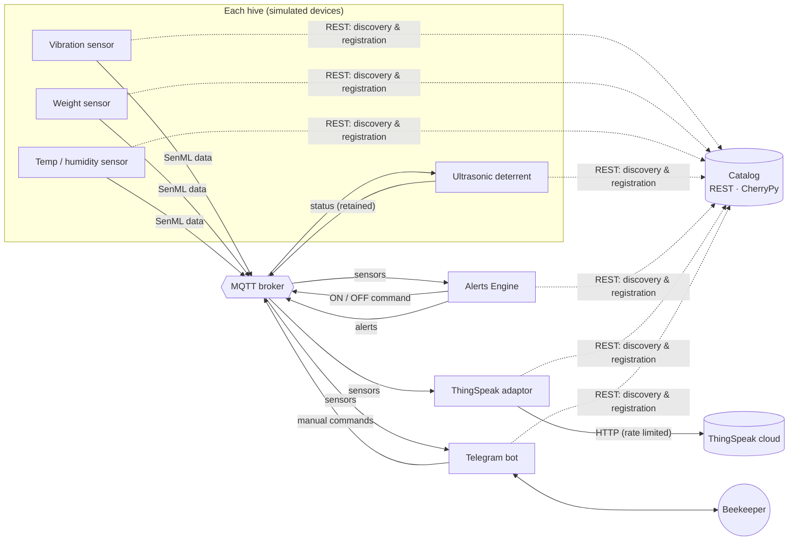

# Apisense — Smart Beehive IoT Platform

Apisense is an IoT platform for remote beehive monitoring, built for the *IoT & Cloud for Sustainable Communities* course (Politecnico di Torino, Group 3).

Every hive has simulated sensors for **vibration**, **weight**, and **temperature/humidity**, plus an **ultrasonic deterrent** actuator. The platform spots possible intrusions (predators, thieves) from abnormal vibrations, switches the deterrent on automatically, notifies the beekeeper on **Telegram**, and stores every reading on **ThingSpeak** for cloud charts.

It follows the microservice pattern taught in the course:

- a **REST Catalog** (CherryPy) acts as the registry,
- **MQTT** (paho-mqtt) carries all real-time data,
- every component finds the broker, hives, thresholds and topics through the Catalog, so none of them is hardcoded.



## Features

- **Catalog web service** (REST, CherryPy). It keeps the hives, their thresholds and the devices with their MQTT topics. Device registration is idempotent. Data is saved to JSON with atomic writes.
- **Hot-plug hives.** You can add or remove a hive while the system runs (CLI, REST or Telegram). Its devices start or stop automatically, and every service picks it up.
- **Intrusion detection with hysteresis.** Each hive runs a state machine. Commands and alerts go out only when the state changes, so a stream of readings doesn't flood the network.
- **Actuator feedback.** The deterrent publishes its real state on a retained status topic.
- **Telegram bot.** It pushes alerts and offers `/status`, `/on`, `/off`, `/threshold` and `/addhive`, plus inline buttons. Only authorised users can control the hives.
- **ThingSpeak integration.** You configure which value goes to which channel field. Uploads respect the free-tier rate limit with a buffer, and failed uploads are retried. With no key set, it runs in dry-run mode and only logs.
- **SenML-style payloads**, so every consumer parses data the same way.
- **One-command start-up** (`run_all.py`) and an **automated test suite**: 23 tests, including end-to-end tests over a real MQTT broker.

## Repository layout

```
Apisense_IoT_Project/
├── catalog.py              REST Catalog (start first)
├── alerts_engine.py        intrusion detection / control strategy
├── thingspeak_adaptor.py   MQTT -> ThingSpeak bridge
├── telegram_bot.py         Telegram notifications & remote control
├── main_sensors.py         runs the sensors of every hive in the Catalog
├── main_actuators.py       runs the actuators of every hive in the Catalog
├── hive_manager.py         CLI: list / create / delete hives, change thresholds
├── run_all.py              starts everything in the right order
├── settings.json           non-secret configuration (broker, intervals, demo hives)
├── secrets.example.json    template for secrets.json (Telegram token, ThingSpeak keys)
├── devices/
│   ├── sensors.py          VibrationSensor, WeightSensor, EnvSensor (simulated)
│   └── actuators.py        DeterrentActuator (simulated)
└── utils/
    ├── basesensor.py       abstract sensor: register -> connect -> sense/publish loop
    ├── baseactuator.py     abstract actuator: register -> subscribe -> actuate + status
    ├── myMQTT.py           paho-mqtt 2.x wrapper (unique IDs, auto re-subscribe)
    ├── catalog_client.py   REST client for the Catalog
    ├── device_manager.py   discovers hives and starts/stops their devices
    ├── senml.py            payload builder/parser
    └── config.py           settings / secrets / logging
tests/                      pytest suite (unit + REST + end-to-end over MQTT)
docs/
├── ARCHITECTURE.md         detailed design: REST API, MQTT topics, payloads, flows
└── REVIEW_REPORT.md        review of the original code: issues found and fixes
```

## Quick start

**Requirements:** Python 3.10 or later (tested on 3.13). Internet access for the public MQTT broker, Telegram and ThingSpeak. Mosquitto is optional; you only need it to use a local broker or to run the end-to-end tests.

```bash
# 1. create a virtual environment and install the dependencies
python -m venv .venv
.venv\Scripts\activate          # Windows
# source .venv/bin/activate     # Linux / macOS
pip install -r requirements.txt

# 2. configure secrets (optional: without them the bot is skipped, ThingSpeak runs in dry-run)
copy Apisense_IoT_Project\secrets.example.json Apisense_IoT_Project\secrets.json
#   then edit secrets.json: Telegram token, authorised user IDs, ThingSpeak write key and field mapping

# 3. start the whole system
python Apisense_IoT_Project/run_all.py
```

On first start-up the Catalog creates `Catalog.json` with the two demo hives listed in `settings.json` (`Hive_01` and `Hive_02`). Then:

```bash
python Apisense_IoT_Project/hive_manager.py list                     # see hives, devices and topics
python Apisense_IoT_Project/hive_manager.py create Hive_03 2.0 "Orchard"   # hot-plug a new hive
python Apisense_IoT_Project/hive_manager.py threshold Hive_01 3.0
curl http://127.0.0.1:8080/hives                                     # REST API
mosquitto_sub -h broker.hivemq.com -t "apisense/#" -v                # watch the MQTT traffic
```

### Running the components one by one

If you don't use `run_all.py`, start the components in this order, each in its own terminal:

| # | Command | Why this order |
|---|---------|----------------|
| 1 | `python Apisense_IoT_Project/catalog.py` | Everyone needs the Catalog to find the broker and topics |
| 2 | `python Apisense_IoT_Project/alerts_engine.py` | Subscribers start before data flows |
| 3 | `python Apisense_IoT_Project/thingspeak_adaptor.py` | |
| 4 | `python Apisense_IoT_Project/telegram_bot.py` | Needs the token in `secrets.json` |
| 5 | `python Apisense_IoT_Project/main_actuators.py` | |
| 6 | `python Apisense_IoT_Project/main_sensors.py` | Data starts flowing |

Every component retries until the Catalog answers, so the order isn't strict, but this order means no messages are missed.

## Telegram bot

| Command | Effect |
|---------|--------|
| `/start` / `/stop` | Subscribe or unsubscribe this chat to alerts |
| `/hives` | List the hives, with inline **ON / OFF / Status** buttons |
| `/status [hive_id]` | Latest readings, alert state and deterrent state |
| `/on <hive_id>` · `/off <hive_id>` | Switch the deterrent manually (aliases `/actuate`, `/deactivate`) |
| `/threshold <hive_id> <g>` | Change the vibration threshold (a `PUT` on the Catalog) |
| `/addhive <hive_id> [g]` | Register a new hive; its devices start automatically |

Only the Telegram user IDs listed in `secrets.json → telegram.authorized_users` can use the bot. To find your ID, message the bot: an unauthorised user gets a reply that includes their ID.

## Configuration

`Apisense_IoT_Project/settings.json` holds the non-secret settings and is committed:

| Key | Default | Meaning |
|-----|---------|---------|
| `catalog.host` / `catalog.port` | `127.0.0.1` / `8080` | Where the Catalog listens. Use `0.0.0.0` to expose it on the LAN. |
| `catalog.bootstrap_hives` | Hive_01, Hive_02 | Demo hives created only when `Catalog.json` doesn't exist yet |
| `mqtt.broker` / `mqtt.port` | `broker.hivemq.com` / `1883` | Broker that the Catalog hands to every component |
| `mqtt.base_topic` | `apisense` | Root of every MQTT topic |
| `sensors.*_interval` | 5 s / 15 s / 15 s | Publishing period of the vibration, weight and environment sensors |
| `sensors.intrusion_probability` | `0.03` | Chance per reading that a simulated intrusion starts |
| `alerts.clear_after` | `3` | Consecutive calm readings needed before an alert is cleared |
| `thingspeak.min_interval` | `16` s | Minimum time between uploads to one channel (free tier: 15 s) |

`Apisense_IoT_Project/secrets.json` holds the secrets and is **gitignored**. Copy it from `secrets.example.json`.

You can override any setting with an environment variable, for example to use a local Mosquitto:

```bash
APISENSE_BROKER=localhost python Apisense_IoT_Project/run_all.py
```

The other variables are `APISENSE_CATALOG_URL`, `APISENSE_BASE_TOPIC`, `APISENSE_INTRUSION_PROBABILITY`, `TELEGRAM_TOKEN`, `APISENSE_LOG_LEVEL=DEBUG`, and more; see `utils/config.py`.

## Tests

```bash
pip install -r requirements.txt
python -m pytest -v
```

- `tests/test_catalog.py` makes real HTTP calls to the CherryPy Catalog: CRUD, validation, idempotent registration and persistence.
- `tests/test_logic.py` holds unit tests for the Alerts Engine state machine, the ThingSpeak mapping and rate limit, the Telegram commands and authorisation, and the sensor simulations.
- `tests/test_integration.py` runs the full flow end to end over a **real MQTT broker**: sensor → Alerts Engine → deterrent ON, alert to Telegram and ThingSpeak → calm → OFF → manual Telegram command. It also covers hot-plugging a hive. It needs Mosquitto on `localhost:1883` and is skipped when no broker is running.

## Documentation

- [docs/ARCHITECTURE.md](docs/ARCHITECTURE.md) covers the components, REST API reference, MQTT topic tree, payload formats, sequence diagrams and the alert state machine.
- [docs/REVIEW_REPORT.md](docs/REVIEW_REPORT.md) lists what was wrong in the original code, what changed and how it was verified.

## License

MIT; see [LICENSE](LICENSE).
