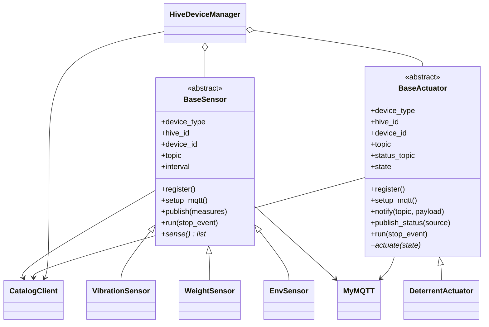
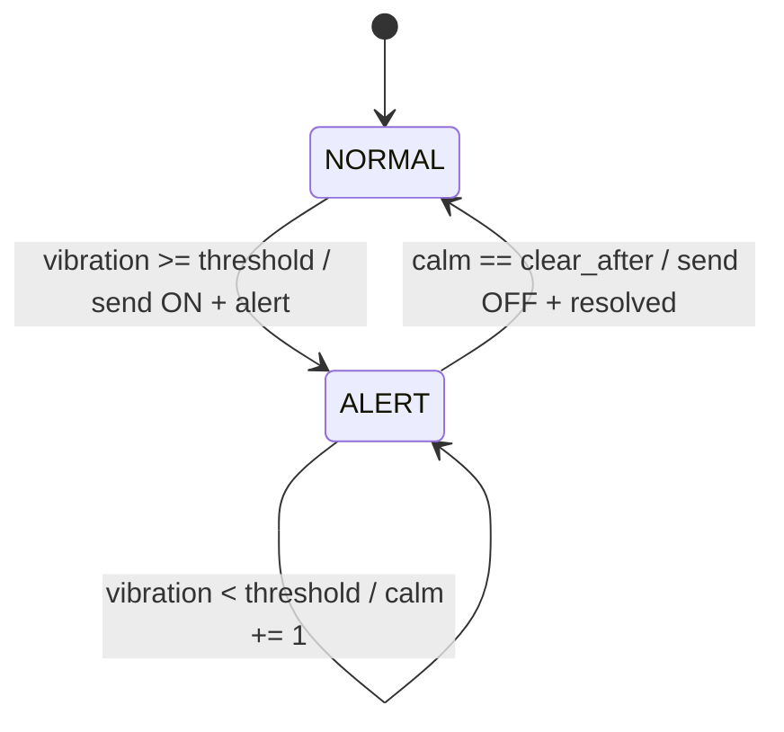
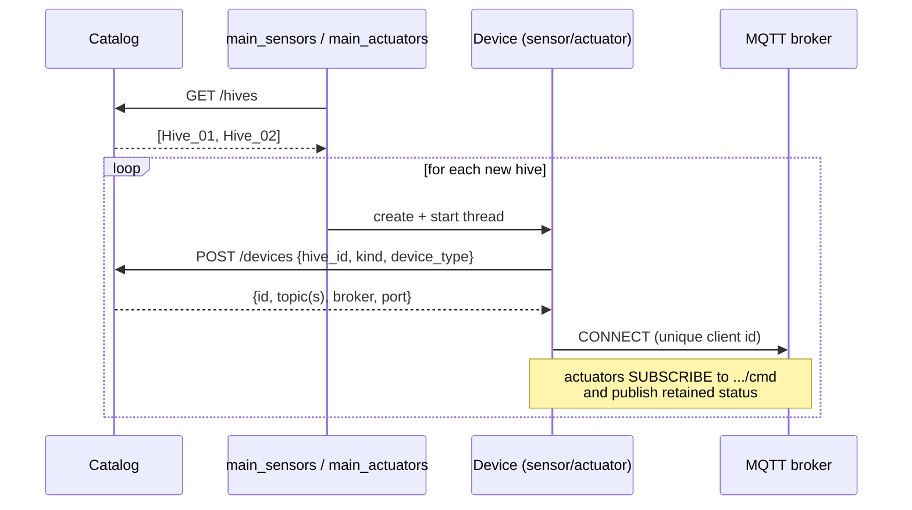
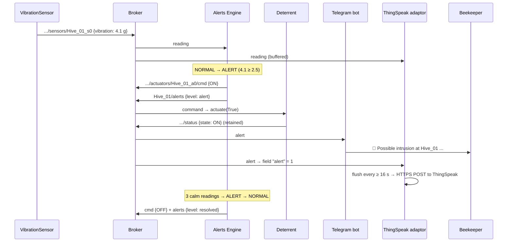
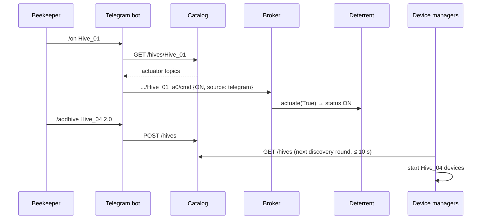

# Apisense: Architecture and Technical Reference

This document explains how Apisense works: what each component does, how the components talk to each other, and the exact REST and MQTT interfaces.

## 1. Design principles

1. **The Catalog is the single source of truth.** It holds the broker address, the base topic, the hives, their thresholds and the devices with their topics. Components only know the Catalog URL and discover everything else at run time.
2. **REST for configuration, MQTT for data.** Slow-changing information (registration, discovery, settings) goes through HTTP request/response. Fast, many-to-many data (readings, commands, alerts) goes through publish/subscribe.
3. **Loose coupling.** Producers don't know their consumers. A sensor publishes once, and the Alerts Engine, the ThingSpeak adaptor and the Telegram bot each receive the reading on their own.
4. **Hot plug.** Hives can be added or removed while the system runs. Every component re-reads the Catalog periodically, and right away when a message arrives from an unknown hive.
5. **Object-oriented devices.** `BaseSensor` and `BaseActuator` contain the full life cycle: register, connect, then loop. A concrete device only implements `sense()` or `actuate()`.

## 2. Components

| Component | File | Talks REST to | MQTT subscribe | MQTT publish |
|-----------|------|---------------|----------------|--------------|
| Catalog | `catalog.py` | (server) | none | none |
| Sensors | `devices/sensors.py`, run by `main_sensors.py` | `POST /devices`, `GET /hives` | none | `…/sensors/<id>` |
| Actuators | `devices/actuators.py`, run by `main_actuators.py` | `POST /devices`, `GET /hives` | `…/actuators/<id>/cmd` | `…/actuators/<id>/status` (retained) |
| Alerts Engine | `alerts_engine.py` | `GET /broker`, `GET /hives` | `<base>/+/sensors/+` | `…/actuators/<id>/cmd`, `<base>/<hive>/alerts` |
| ThingSpeak adaptor | `thingspeak_adaptor.py` | `GET /broker` | `<base>/+/sensors/+`, `<base>/+/alerts` | none (HTTP to ThingSpeak) |
| Telegram bot | `telegram_bot.py` | `GET /hives`, `GET /hives/<id>`, `POST /hives`, `PUT /hives/<id>` | `<base>/+/alerts`, `<base>/+/sensors/+`, `<base>/+/actuators/+/status` | `…/actuators/<id>/cmd` |
| Hive manager CLI | `hive_manager.py` | all `/hives` endpoints | none | none |

### 2.1 Catalog (`catalog.py`)

- `CatalogStore` holds the business logic and is independent of the web framework, which makes it unit-testable. `CatalogREST` is the CherryPy `MethodDispatcher` layer that maps HTTP verbs to store methods and converts exceptions to status codes (404, 409, 400).
- **Thread safety.** CherryPy serves requests from a thread pool, so every read and write holds an `RLock`.
- **Persistence.** `Catalog.json` is rewritten atomically after every change: the store writes a temp file, then calls `os.replace`. A crash can't leave a corrupted file. The broker settings are **not** stored in the file; they come from `settings.json`. Topics are rebuilt on start-up, so changing `mqtt.base_topic` is safe.
- **Provisioning.** Creating a hive pre-registers its standard devices: three sensors (vibration, weight, environment) and one actuator (deterrent). Every service then knows the topics before the devices come online.
- **Idempotent registration.** `POST /devices` with the same `(hive, kind, type)` always returns the same device, and only updates `last_seen`. Restarting a device never creates duplicates.
- **Validation.** `hive_id` must match `^[A-Za-z0-9_-]{1,32}$`, because characters such as `/`, `+` or `#` would break MQTT topics. Thresholds must be numbers in `(0, 100]`. Only known device types are accepted.

### 2.2 Devices (`utils/basesensor.py`, `utils/baseactuator.py`, `devices/`)



**Simulation models.** Each sensor keeps an internal state, so readings change realistically from one sample to the next:

| Sensor | Quantity (unit) | Model |
|--------|-----------------|-------|
| `VibrationSensor` | `vibration` (g) | Background noise: \|N(0.6, 0.3)\|. With probability `intrusion_probability` per reading, an intrusion **burst** of 3–6 readings in U(3.2, 5.0) starts. |
| `WeightSensor` | `weight` (kg) | Random walk with a small positive drift (+0.01 kg per sample, standing in for the nectar flow) and σ = 0.05 kg, clamped to 15–80 kg |
| `EnvSensor` | `temperature` (Cel), `humidity` (%RH) | Mean-reverting random walk around 34.5 °C and 60 %RH. Bees keep the brood nest at a stable temperature. |

**`HiveDeviceManager`** (`utils/device_manager.py`) polls `GET /hives` every `discovery_interval` seconds:

- For each **new** hive it builds the hive's devices with a factory function and runs each device in its own thread.
- For each **deleted** hive it sets that hive's stop event, and the devices shut down cleanly.

`main_sensors.py` and `main_actuators.py` are both thin wrappers around this class.

### 2.3 MQTT wrapper (`utils/myMQTT.py`)

The wrapper is built on paho-mqtt 2.x (`CallbackAPIVersion.VERSION2`) and keeps the `notify(topic, payload)` callback convention from the course. On top of that:

- **Unique client IDs.** A random suffix is added to every ID. On a public broker, two clients with the same ID keep disconnecting each other.
- **Re-subscription.** Subscriptions are stored and replayed in `on_connect`, so they survive an automatic reconnect (back-off between 1 and 30 s).
- **Connection wait.** `start()` waits until the client is connected, so the first message isn't lost.
- **Error isolation.** An exception inside a `notify` handler is logged and can't kill the network thread.
- **QoS.** Every publish and subscribe uses QoS 1.

### 2.4 Alerts Engine (`alerts_engine.py`)

This is the control strategy. The engine subscribes to every sensor topic with a single wildcard and processes vibration readings. It keeps one state machine per hive:



- **Hysteresis.** The `clear_after` setting (default 3) stops the deterrent from flapping on and off around the threshold.
- **No flooding.** The engine sends commands and alerts **only on transitions**. The old code sent a command on every reading.
- **Live thresholds.** The engine reloads thresholds and the hive list from the Catalog every `catalog_refresh` seconds. It also reloads right away, rate-limited to once every 2 s, when a reading comes from an unknown hive. A threshold changed with `/threshold` or `hive_manager.py` therefore takes effect without a restart.
- **All deterrents.** The command goes to every actuator of type `deterrent` that belongs to the hive.

### 2.5 ThingSpeak adaptor (`thingspeak_adaptor.py`)

- **Mapping.** The adaptor maps each pair `<hive_id>/<quantity>` to a channel field number, using the configuration in `secrets.json`. `*` matches any hive. One configuration can feed several channels, for example one channel per hive.
- **Buffering.** Values are buffered per channel; for each field, the latest value wins. A background loop flushes a channel when at least `min_interval` seconds have passed since its last upload. The free tier allows one update every 15 s.
- **Retries.** ThingSpeak signals a rejected update by answering `0`. The adaptor then keeps those values for the next round instead of dropping them.
- **Dry-run.** When no write key is configured, the adaptor only logs what it would upload, so the system still runs without a ThingSpeak account.

### 2.6 Telegram bot (`telegram_bot.py`)

- `BotLogic` contains the command handling and the caches (latest readings, actuator states, alerts) and doesn't depend on the Telegram library, so it can be tested on its own. `HiveBot` connects `BotLogic` to pyTelegramBotAPI (long polling) and to MQTT.
- **Notifications.** The bot forwards every message on `<base>/+/alerts` to the subscribed chats. Those chats come from `alert_chat_ids` plus any chat that sent `/start`; the latter are saved in `bot_chats.json`.
- **Discovery.** Actuator topics and hive IDs always come from the Catalog. Nothing is hardcoded and the bot never reads the Catalog file directly.
- **Authorisation.** Only the Telegram user IDs listed in `authorized_users` can run commands. An empty list allows everyone, and the bot logs a warning at start-up.

## 3. REST API (Catalog)

Base URL: `http://127.0.0.1:8080`. All request and response bodies are JSON. Errors look like `{"error": "...", "status": "404 Not Found"}`.

| Method | Path | Body | Success | Errors |
|--------|------|------|---------|--------|
| GET | `/` | none | 200: full catalog (broker info + `hives`) | none |
| GET | `/broker` | none | 200: `{"broker","port","base_topic"}` | none |
| GET | `/hives` | none | 200: list of hives | none |
| GET | `/hives/<hive_id>` | none | 200: hive | 404 |
| POST | `/hives` | `{"hive_id", "vibration_threshold"?, "location"?}` | 201: created hive | 400 invalid, 409 exists |
| PUT | `/hives/<hive_id>` | `{"vibration_threshold"?, "location"?}` | 200: updated hive | 400, 404 |
| DELETE | `/hives/<hive_id>` | none | 200: `{"status":"deleted"}` | 404 |
| POST | `/devices` | `{"hive_id", "kind": "sensor"\|"actuator", "device_type"}` | 201 if new, 200 if it already exists: device + `hive_id`, `vibration_threshold`, `broker`, `port`, `base_topic` | 400, 404 |

Valid `device_type` values are `vibration`, `weight` and `environment` for sensors, and `deterrent` for actuators.

Example hive record:

```json
{
  "hive_id": "Hive_01",
  "vibration_threshold": 2.5,
  "location": "Politecnico di Torino",
  "created": 1736500000.0,
  "alerts_topic": "apisense/Hive_01/alerts",
  "sensors": [
    {"id": "Hive_01_s0", "kind": "sensor", "type": "vibration",
     "topic": "apisense/Hive_01/sensors/Hive_01_s0", "registered": 1736500000.0, "last_seen": 1736500100.0},
    {"id": "Hive_01_s1", "kind": "sensor", "type": "weight",      "topic": "apisense/Hive_01/sensors/Hive_01_s1", "...": "..."},
    {"id": "Hive_01_s2", "kind": "sensor", "type": "environment", "topic": "apisense/Hive_01/sensors/Hive_01_s2", "...": "..."}
  ],
  "actuators": [
    {"id": "Hive_01_a0", "kind": "actuator", "type": "deterrent",
     "topic": "apisense/Hive_01/actuators/Hive_01_a0/cmd",
     "status_topic": "apisense/Hive_01/actuators/Hive_01_a0/status", "...": "..."}
  ]
}
```

Examples with curl:

```bash
curl http://127.0.0.1:8080/broker
curl -X POST http://127.0.0.1:8080/hives -H "Content-Type: application/json" -d "{\"hive_id\":\"Hive_03\",\"vibration_threshold\":2.0}"
curl -X PUT  http://127.0.0.1:8080/hives/Hive_03 -H "Content-Type: application/json" -d "{\"vibration_threshold\":3.5}"
curl -X DELETE http://127.0.0.1:8080/hives/Hive_03
```

## 4. MQTT interface

### 4.1 Topic tree

```
apisense/                                   (base_topic, configurable)
└── <hive_id>/
    ├── sensors/<sensor_id>                 sensor readings (SenML)          QoS 1
    ├── actuators/<actuator_id>/cmd         commands to the actuator         QoS 1
    ├── actuators/<actuator_id>/status      actual actuator state            QoS 1, retained
    └── alerts                              alert / resolved notifications   QoS 1
```

Separate `sensors/`, `actuators/` and `alerts` levels mean each consumer subscribes with a precise wildcard, such as `apisense/+/sensors/+`, and never receives messages it doesn't need. The original code subscribed to `apisense/+/+` and had to tell commands and readings apart by inspecting each payload.

### 4.2 Payloads

**Sensor reading** (SenML-style; one message can carry several quantities):

```json
{
  "bn": "apisense/Hive_01/sensors/Hive_01_s2",
  "hive_id": "Hive_01",
  "device_id": "Hive_01_s2",
  "type": "environment",
  "e": [
    {"n": "temperature", "u": "Cel", "t": 1736500000.0, "v": 34.62},
    {"n": "humidity",    "u": "%RH", "t": 1736500000.0, "v": 58.10}
  ]
}
```

**Actuator command:**

```json
{"command": "ON", "source": "alerts_engine", "reason": "vibration 3.41 g >= threshold 2.50 g", "timestamp": 1736500000.0}
```

`source` is `alerts_engine` or `telegram`. The `command` value is case-insensitive and must be `ON` or `OFF`; anything else is ignored with a warning.

**Actuator status** (retained, so a new subscriber gets the current state immediately):

```json
{"hive_id": "Hive_01", "device_id": "Hive_01_a0", "type": "deterrent", "state": "ON", "source": "alerts_engine", "timestamp": 1736500000.1}
```

**Alert:**

```json
{"hive_id": "Hive_01", "level": "alert", "event": "intrusion", "value": 3.41, "threshold": 2.5,
 "timestamp": 1736500000.0, "msg": "Possible intrusion at Hive_01: vibration 3.41 g >= threshold 2.50 g. Deterrent switched ON."}
```

`level` is `alert` when an intrusion starts and `resolved` when the hive is calm again.

## 5. Main flows

### 5.1 Start-up and registration



### 5.2 Intrusion detection



### 5.3 Manual control and hot-plug from Telegram



## 6. Configuration and secrets

- `settings.json` (committed) holds the non-secret settings, described in the README.
- `secrets.json` (gitignored) holds the Telegram token, the authorised users and alert chats, and the ThingSpeak channels with their field mapping. `secrets.example.json` is the template.
- Environment variables override both files (see `utils/config.py`). They are useful for tests, containers and switching to a local broker (`APISENSE_BROKER=localhost`).
- Runtime state (`Catalog.json`, `bot_chats.json`) is gitignored.

## 7. Known limitations and possible extensions

- **Unsecured public broker.** `broker.hivemq.com` has no authentication and anyone can publish on `apisense/#`. A real deployment would use a private broker with TLS and per-device credentials.
- **No authentication on the Catalog REST API.** It listens on `127.0.0.1` by default; expose it only on a trusted network.
- **Single Catalog instance.** It is a single point of failure. That's acceptable for a prototype, and every client retries until the Catalog comes back.
- **Possible extensions:**
  - honey-yield forecasting from the weight trend;
  - swarm detection (a sudden weight drop);
  - temperature alerts;
  - a web dashboard that reads from the Catalog and ThingSpeak.
